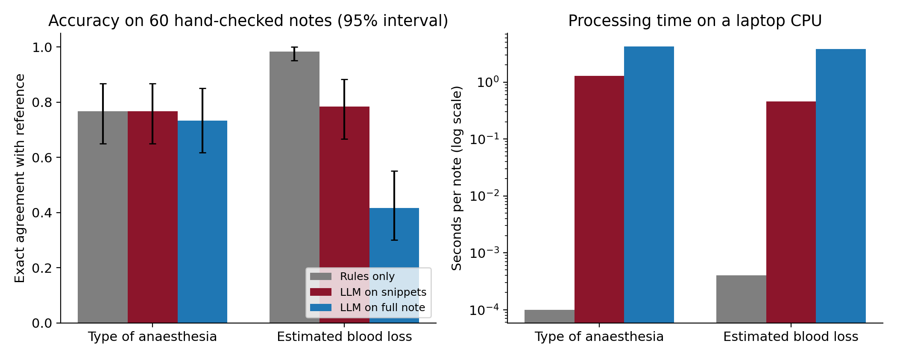
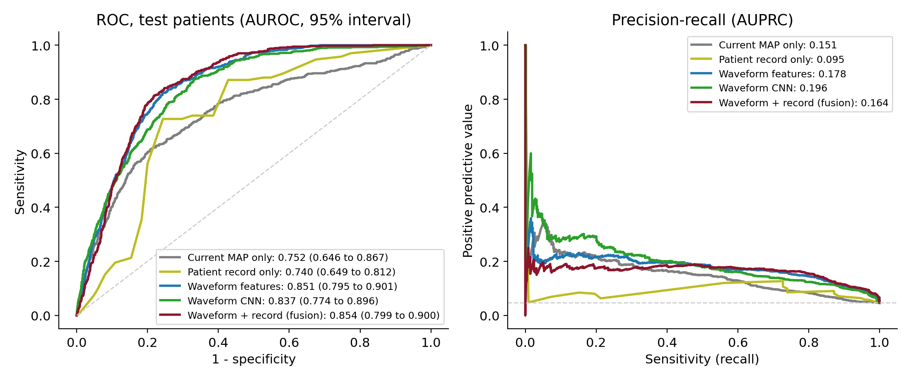
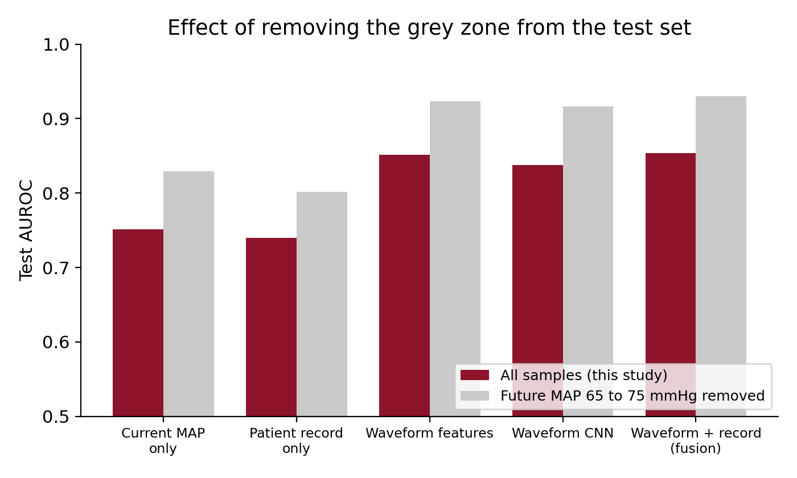

# Perioperative data: note extraction with a local LLM, and early prediction of hypotension

A study exercise on open perioperative data, written to understand two lines of work
of the Kovacheva Lab (Brigham and Women's Hospital): the extraction of variables from
clinical notes with regular expressions and locally hosted language models
(SPELL, Kleinlein et al., 2026), and the modelling of physiological waveforms together
with patient-record data.

It has two parts that share one idea: **always measure a model against the simplest thing
that could work, on patients or notes it has not seen.**

| Part | Question | Data | Simple reference |
|---|---|---|---|
| 1. Notes | Does a small local LLM extract blood loss and type of anaesthesia from operative notes better than regular expressions, and does it help to give it short snippets? | 881 operative notes from MTSamples; 60 hand-checked | regular expressions only |
| 2. Waveform and record | Can hypotension be predicted 5 minutes ahead from the arterial waveform, and does the patient record add anything? | 200 operations from VitalDB (194 usable), 63,336 samples | the current mean arterial pressure alone |

Everything runs on a laptop CPU. No data are stored in this repository; the scripts
download them from their public sources.

> Scope. This is a learning project on public data, done as a short exercise. It is not a
> clinical tool and the numbers come from small samples. Limits are listed at the end of
> each part and in [docs/METHODS.md](docs/METHODS.md).

---

## Part 1. Operative notes: rules, LLM on snippets, LLM on the full note

**Set-up.** Two variables are extracted from each operative note: estimated blood loss
(a number in mL, `minimal`, or `not stated`) and type of anaesthesia (five classes).
Three methods are compared on 60 notes labelled by hand:

1. regular expressions only;
2. regular expressions retrieve short snippets, and a local LLM (Qwen2.5-0.5B-Instruct)
   reads only those snippets;
3. the same LLM reads the whole note.

**Results** (exact agreement with the reference, 95% bootstrap interval; time is per note
on a 4-core laptop CPU).

| Variable | Method | Accuracy | 95% interval | Seconds per note |
|---|---|---|---|---|
| Estimated blood loss | Rules only | 98.3% | 95.0 to 100 | below 0.001 |
| | LLM on snippets | 78.3% | 66.7 to 88.3 | 0.46 |
| | LLM on full note | 41.7% | 30.0 to 55.0 | 3.82 |
| Type of anaesthesia | Rules only | 76.7% | 65.0 to 86.7 | below 0.001 |
| | LLM on snippets | 76.7% | 65.0 to 86.7 | 1.28 |
| | LLM on full note | 73.3% | 61.7 to 85.0 | 4.26 |

Retrieval recall (notes that state a value and had a snippet retrieved): 96.7% for blood
loss, 92.9% for anaesthesia.



**What I take from it.**

* **Snippets help a small model a great deal.** For blood loss, restricting the model to
  the retrieved snippet raised accuracy from 42% to 78% and cut inference time by 88%
  (70% for anaesthesia). This is the central point of SPELL, reproduced here at a much
  smaller scale: a short, relevant context is both cheaper and safer.
* **A 0.5-billion-parameter model does not beat good regular expressions on a templated
  field.** "ESTIMATED BLOOD LOSS: 200 mL" is easy for a rule and the rule was right in
  59 of 60 notes.
* **The two methods fail differently on anaesthesia.** The rule reads only the
  "ANESTHESIA:" header and misses the 14 notes where the anaesthetic is described in the
  narrative or the header is absent. The LLM recovers seven of those, but invents
  "general endotracheal" for sedation cases. Same accuracy, different errors.
* **The dominant LLM error is copying the example from the prompt.** On full notes with
  no blood loss stated, the model answered "minimal" 20 times, which is the example value
  in the instruction. With snippets, when nothing is retrieved the model is not called at
  all, so this error cannot occur. In the anaesthesia task the echoed example was
  "general endotracheal".
* The prompt was chosen on 30 other notes and was not changed after seeing these errors.

**Limits.** Sample transcriptions, not hospital records. Sixty notes. Reference labels
prepared with AI assistance and reviewed by the author, not by a clinician. One small
model; a larger local model is the obvious next step.

---

## Part 2. Predicting hypotension five minutes ahead

**Set-up.** From 30 seconds of arterial waveform and 5 minutes of mean arterial pressure
(MAP) history, predict whether MAP will stay below 65 mmHg for the whole minute that
starts 5 minutes later. Only moments when the patient is not yet hypotensive are used,
so the model has to predict the onset.

Patients are split 60 / 20 / 20 (116 training, 38 validation, 40 test). Settings are
chosen on validation patients. Intervals come from resampling test patients.

| Split | Patients | Samples | Events | Event rate |
|---|---|---|---|---|
| Training | 116 | 37,653 | 1,096 | 2.9% |
| Validation | 38 | 13,444 | 328 | 2.4% |
| Test | 40 | 12,239 | 568 | 4.6% |

**Results on the 40 test patients.**

| Model | Input | AUROC (95% interval) | AUPRC | Sens. | Spec. | PPV |
|---|---|---|---|---|---|---|
| Current MAP only | 1 number | 0.752 (0.646 to 0.867) | 0.151 | 59.5% | 80.6% | 13.0% |
| Patient record only | 26 variables, no waveform | 0.740 (0.649 to 0.812) | 0.095 | 88.0% | 47.3% | 7.5% |
| Waveform features | 20 features | 0.851 (0.795 to 0.901) | 0.178 | 84.3% | 72.8% | 13.1% |
| Waveform CNN | raw 30-s waveform | 0.837 (0.774 to 0.896) | 0.196 | 79.2% | 72.7% | 12.4% |
| Fusion: waveform + record | 46 variables | 0.854 (0.799 to 0.900) | 0.164 | 62.3% | 85.4% | 17.2% |

Sensitivity, specificity and PPV are at the threshold chosen on validation patients.



| Comparison | Difference in AUROC (95% interval) |
|---|---|
| Waveform features minus current MAP | +0.100 (+0.012 to +0.194) |
| Fusion minus waveform features | +0.002 (-0.023 to +0.021) |
| CNN minus waveform features | -0.014 (-0.042 to +0.007) |

**What I take from it.**

* **Waveform and trend features add information over the current MAP, but less than this
  one split suggests.** On this split the gain is 0.10 in AUROC. Repeating the patient
  split ten times (table below) gives a mean gain of 0.04, positive in all ten splits.
  The split above happens to be the one with the largest gain, so 0.04 is the fairer
  figure. The most useful inputs are the diastolic pressure, the current MAP, the lowest
  MAP in the last five minutes and the time already spent below 75 mmHg.
* **The patient record added nothing on top of the waveform** (+0.002 here, and -0.012 on
  average over ten splits, better in 3 of 10). With 116 training patients, patient-level variables such as age, ASA class or type of
  surgery cannot be learned reliably; removing any one group of record variables changed
  the test AUROC by less than 0.005. The record-only model was also unstable (validation
  AUROC 0.54, test 0.74). I would expect the record to matter more with thousands of
  patients; this result does not show it.
* **The small CNN did not beat hand-made features.** It started to overfit after five
  epochs.
* **Alarms would mostly be false.** At a prevalence of 4.6%, the best positive predictive
  value is 17%. AUROC alone hides this; the precision-recall curve shows it.

### Robustness: ten different patient splits

Forty test patients are few, so the 60 / 20 / 20 split was redrawn with ten seeds
(`python -m periop.fusion.repeat`). Seed 0 is the split reported above.

| Test AUROC over 10 splits | Mean | SD | Lowest | Highest |
|---|---|---|---|---|
| Current MAP only | 0.805 | 0.052 | 0.703 | 0.868 |
| Waveform features | 0.847 | 0.027 | 0.810 | 0.884 |
| Fusion | 0.835 | 0.021 | 0.811 | 0.874 |
| Waveform features minus current MAP | +0.042 | 0.034 | +0.009 | +0.108 |
| Fusion minus waveform features | -0.012 | 0.015 | -0.039 | +0.009 |

The current MAP alone is a strong predictor (0.70 to 0.87 depending on which patients are
in the test set). The waveform model is better in every split and varies less from split
to split.

### The grey zone

Part of the literature removes the samples whose future MAP lies between 65 and 75 mmHg.
Applying that selection to the same test patients and the same models raises every AUROC:

| Model | All samples | Grey zone removed |
|---|---|---|
| Current MAP only | 0.752 | 0.829 |
| Waveform features | 0.851 | 0.923 |
| Waveform CNN | 0.837 | 0.916 |
| Fusion | 0.854 | 0.930 |



The models are the same; only the choice of test samples changed. This is why the
primary analysis keeps every sample and reports the current MAP as the reference
(Enevoldsen and Vistisen, Anesthesiology 2022).

Other figures: [calibration](results/figures/waveform_calibration.png),
[feature importance](results/figures/fusion_importance.png),
[one test patient](results/figures/example_case.png).

**Limits.** One hospital and 200 patients. Predicted probabilities are too high because
of class weighting and would need recalibration. Consecutive samples are correlated.
Treatment given in response to a falling pressure is not modelled. No external
validation.

---

## How the two parts would meet

In a hospital data platform, the outcome and the context of a waveform model often live
in free text: blood loss, the anaesthetic technique, complications. Part 1 is the step
that turns that text into variables; Part 2 is the model that would use them. Here the
two parts use different public datasets, because no open dataset has both operative
notes and waveforms for the same patients. The free-text fields that VitalDB does have
(operation name and diagnosis) are used in the fusion model.

## Run it

```bash
pip install -r requirements.txt
pip install -e .

# Part 1 (needs data/mtsamples.csv and the model in models/qwen2.5-0.5b-instruct)
python -m periop.notes.evaluate

# Part 2
python -m periop.waveform.download --n-cases 200     # about 570 MB from VitalDB
python -m periop.waveform.segments                   # prediction samples
python -m periop.fusion.run                          # train and evaluate the five models
python -m periop.fusion.repeat --seeds 10            # same comparison over ten patient splits
python -m periop.figures                             # figures in results/figures

pytest -q                                            # 15 unit tests, no data needed
```

Data sources: [MTSamples](https://mtsamples.com) (the CSV used here is the widely
mirrored `mtsamples.csv`), [VitalDB](https://vitaldb.net) (CC BY-NC-SA 4.0) and
[Qwen2.5-0.5B-Instruct](https://huggingface.co/Qwen/Qwen2.5-0.5B-Instruct) (Apache-2.0).

## Layout

```text
src/periop/
  notes/      select.py     operative notes from MTSamples
              snippets.py   regular-expression retrieval and rule baselines
              llm.py        local LLM inference and answer normalisation
              evaluate.py   three-method comparison
  waveform/   download.py   VitalDB arterial waveforms
              segments.py   signal quality, MAP, labelled samples
              features.py   beat and trend features
              cnn.py        1-D CNN
              evaluate.py   patient-level bootstrap metrics
  fusion/     clinical.py   patient-record encoder (numeric, categorical, text)
              run.py        training and evaluation of the five models
              repeat.py     robustness over repeated patient splits
  figures.py
annotations/  reference_labels.csv   60 hand-checked notes
results/      metrics and figures of the run reported above
docs/         METHODS.md             definitions and protocol
tests/        unit tests on synthetic inputs
```

## References

* Kleinlein R, et al. SPELL: a scalable NLP method using regular expressions and large
  language models for clinical information extraction. Comput Methods Programs Biomed, 2026.
* Cohen RY, et al. A methodology for a scalable, collaborative, and resource-efficient
  platform, MERLIN, to facilitate healthcare AI research. IEEE J Biomed Health Inform, 2023.
* Lee HC, et al. VitalDB, a high-fidelity multi-parameter vital signs database in surgical
  patients. Scientific Data, 2022.
* Enevoldsen J, Vistisen ST. Performance of the Hypotension Prediction Index may be
  overestimated due to selection bias. Anesthesiology, 2022;137:283-289.

## Author and licence

Nida Nasir. Code under the MIT licence. Written with the help of an AI coding assistant;
the design choices, checks and conclusions are the author's responsibility.
